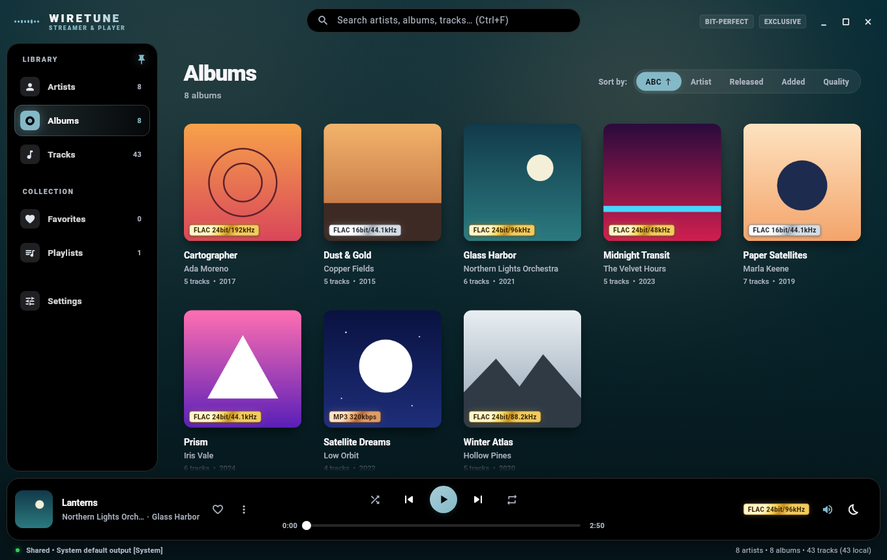
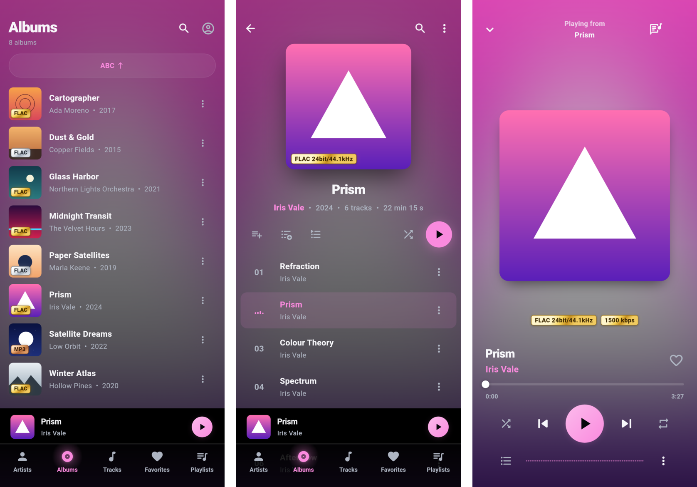

# Wiretune

**Lossless music player for your own server and local files.**

Wiretune has two parts:

- **Server**: runs at home, indexes your music folder and streams it.
- **Player**: plays from the server, a local folder, or both. Runs on Linux, Windows, macOS, Android (phone, tablet, TV,
  Auto), iOS and Samsung Tizen TVs. On a computer it can play bit-perfect to your DAC.

No cloud, no third-party account, no telemetry. The only internet requests are artist pictures, missing lyrics, album
genres and labels, track credits, and the update check. Each can be turned off ([details](SECURITY.md#what-leaves-your-network)).





<sub>The albums, artists and covers in these pictures are made up.</sub>

## Features

- Artists, albums, tracks, search, queue, favorites, playlists, sleep timer.
- Gapless playback: FLAC, ALAC, WAV, AIFF, APE, WavPack, DSD (as PCM), MP3, AAC, Vorbis, Opus.
- Synced lyrics, from the file or [LRCLIB](https://lrclib.net).
- Quality badge on every album and track: hi-res, CD or lossy.
- Genres, labels and credits from Deezer and MusicBrainz where the tags lack them; related artists and similar albums.
- One account per listener: favorites, playlists and plays on every device. A phone joins by scanning a QR code.
- *Your listening*: your most played artists, albums, tracks and genres, and the minutes, by month, year or all time.
- Autoplay: when the queue ends, similar music plays on.
- Offline downloads that stay in sync with the server, and a cache of the tracks you played.
- A ten-band equalizer, and a lower streaming quality for a slow connection or for mobile data.
- Remote control: play on and control your other devices, a friend's TV, or a UPnP/DLNA streamer.
- Friends on your server: recommendations, listening together, shared playlists, and Blends (a playlist mixed from
  what two friends play and love).
- Android: a home-screen widget, and a heart and shuffle in the notification and the car.
- The players offer new releases and install them.
- English, Hungarian, German.

## Platform support

| | Linux | Windows | macOS | Android | Android TV | Android Auto | iOS | Tizen TV |
|---|---|---|---|---|---|---|---|---|
| Play a server library | Yes | Yes | Yes | Yes | Yes | Browse and play | Yes | Yes |
| Play a local folder | Yes | Yes | Yes | Yes | No | No | No | No |
| Exclusive / bit-perfect | Yes | Yes | Untested | No | No | No | No | No |
| Spectrum analyzer | With `ffmpeg` | With `ffmpeg` | With `ffmpeg` | Phone | No | No | Untested | No |
| System media controls | MPRIS | Media keys, while focused | Media keys, Now Playing | Notification, lock screen | Remote | The car | Lock screen, Control Center | Remote, in the app |
| Run the server | Yes | Yes | Yes | — | — | — | — | — |
| [Tried on real hardware](docs/development.md#what-has-been-tried) | Yes | Yes | No | Phone | No | No | iPhone | Briefly |

Bit-perfect sets up an untouched path to the DAC and shows the format the player opened, but doesn't measure what the
DAC receives ([audio.md](docs/audio.md#bit-perfect)). Samsung TVs use their own decoder, so some formats may not play
([audio.md](docs/audio.md#tizen)).

## Download

From the [latest release](https://github.com/wirekurosastak/Wiretune/releases/latest):

| For | Take |
|---|---|
| Linux | The `.tar.gz` (run `./install.sh` in it), or the `.deb` or `.rpm` |
| Windows | The `-setup.exe`. The portable `.zip` doesn't update itself |
| macOS | The `.dmg`. It isn't notarized: allow it once in *System Settings → Privacy & Security* |
| Android | The `arm64-v8a` APK (most phones and TVs), or `armeabi-v7a` for older ones |
| The server | `wiretune-server-…` for your system, or the image `ghcr.io/wirekurosastak/wiretune-server` ([Docker](docs/server.md#docker)) |

iPhone, iPad and Samsung TVs: build the player yourself ([building.md](docs/building.md)).

## Build from source

Install the dependencies ([building.md](docs/building.md)), then on Linux:

```bash
dart tool/build.dart server linux
dist/server/bin/wiretune_server --library ~/Music      # the server
dist/linux/wiretune                                     # the player
```

In the player, connect to the server and create the first account with the setup code from the server log
([first start](docs/user-guide.md#first-start)). For access away from home, use Tailscale or HTTPS
([how](docs/server.md#away-from-home)).

## Documentation

| To | Read |
|---|---|
| Build the server and the players | [Building](docs/building.md) |
| Run the server: Docker, systemd, access away from home, accounts, backups | [Server](docs/server.md) |
| Use the player | [User guide](docs/user-guide.md) |
| Set up exclusive or bit-perfect output | [Audio](docs/audio.md) |
| See what leaves your network, or report a security problem | [Security](SECURITY.md) |
| Change the code | [Development](docs/development.md), [Contributing](CONTRIBUTING.md), [HTTP API](docs/api.md) |
| Publish a release | [Releasing](docs/releasing.md) |

## Credits

Playback: [media_kit](https://github.com/media-kit/media-kit) (libmpv and FFmpeg). System media controls:
[audio_service](https://pub.dev/packages/audio_service).

## License

Copyright (C) 2026 wirekurosastak. [GNU AGPL v3](LICENSE) with the additional terms in [NOTICE.md](NOTICE.md).
A modified version must keep the same license, publish its source (also to network users), keep Wiretune's copyright
notices, say it's based on Wiretune, and use a different name.
