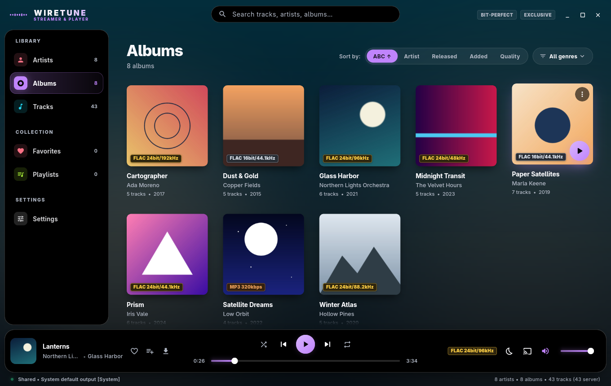
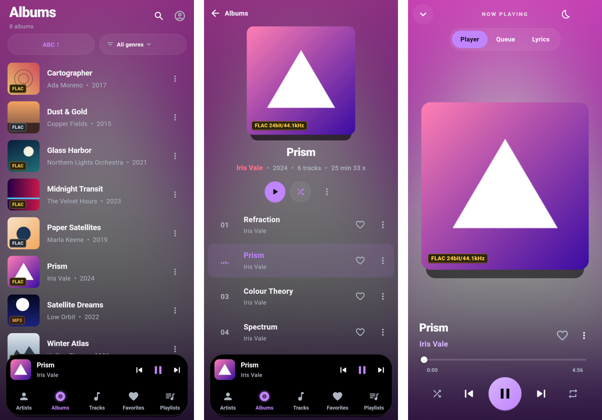

# Wiretune

**Your lossless collection, on your own hardware, played properly.**

You have a folder of FLACs: a few hundred albums ripped over the years, maybe a pile of 24/96 downloads. You don't want
a subscription, you don't want to upload anything, and you'd like the player to stay out of the way between the file
and the DAC.

Wiretune is two programs. A **server** you run at home indexes the folder and streams it over your network. A
**player** browses, queues and plays it, on Linux, Windows, macOS, Android (phone, tablet, TV and Auto), iOS and
Samsung's Tizen TVs. On a computer it can skip the system mixer and play bit-perfect to your DAC. It also plays a plain
folder with no server at all, or both at once.

No cloud, no account on somebody else's computer, no telemetry. The only things that reach the internet are artist
pictures and lyrics for tracks that have none, and you can turn both off ([SECURITY.md](SECURITY.md#players)).





<sub>The albums, artists and covers in these pictures are made up.</sub>

## What you get

- Artists, albums, tracks, search, a queue with shuffle and repeat, favorites, playlists, a sleep timer, and lyrics
  that follow the song (from the file, or from [LRCLIB](https://lrclib.net) when the file has none).
- New music shows up by itself: copy it into the folder, and about ten seconds after the copying stops every player
  shows it. No rescan, no restart.
- A quality tag on every album and track: **gold** for hi-res, **silver** for CD-quality lossless, **bronze** for
  lossy. A 64-band spectrum analyzer on the desktop.
- Favorites, play counts and playlists kept on your server, per account, so they follow you from device to device.
- Downloads for offline listening (a track, an album, an artist, a playlist or your favorites), kept in step with the
  server.
- Remote control between your devices: see and steer what the desktop plays from your phone, or move the music from
  one to the other.
- Gapless playback, and one decoder everywhere but Tizen (FFmpeg, inside libmpv): FLAC, ALAC, WAV, AIFF, APE,
  WavPack, DSD, MP3, AAC, Vorbis, Opus.
- Lock-screen controls on phones, Android Auto in the car, a remote-friendly TV layout, MPRIS on Linux, and the
  interface in English, Hungarian or German.

## What works where

| | Linux | Windows | macOS | Android | Android TV | Android Auto | iOS | Tizen TV |
|---|---|---|---|---|---|---|---|---|
| Play a server library | Yes | Yes | Yes | Yes | Yes | Browse and play | Yes | Yes |
| Play a local folder | Yes | Yes | Yes | Yes, **not tried on a phone** | No | No | No | No |
| Exclusive / bit-perfect | Yes (ALSA `hw:` devices) | Written, **not tried on a DAC** | Written, **not tried on a DAC** | No | No | No | No | No |
| Spectrum analyzer | With `ffmpeg` | With `ffmpeg` | With `ffmpeg` | No | No | No | No | No |
| System media controls | MPRIS | No | Media keys, Now Playing | Notification, lock screen | Remote | The car | Lock screen, Control Center | Remote, in the app |
| Run the server | Yes | Yes | Yes | — | — | — | — | — |

"Supported" isn't the same as "tried on the real thing":
[development.md](docs/development.md#what-has-actually-been-tried) says which platforms have actually run. And
bit-perfect is only as good as the path behind it, so read [audio.md](docs/audio.md) before you lean on the word.

## Build and start

Install what your system needs ([building.md](docs/building.md) has one command per system), then build the server
and a player, for example on Linux:

```bash
dart tool/build.dart server linux
dist/server/bin/wiretune_server --library ~/Music      # the server
dist/linux/wiretune                                     # the player
```

In the player, enter `http://<server-ip>:5200` and press **Connect**. A fresh server asks you to create the first
account, which becomes the administrator, with the **setup code** the server printed in its log. There are no default
passwords. Only want to play a folder on this computer or Android phone? Choose **Continue without a server** and point
*Settings* at your music.

## Documentation

- [User guide](docs/user-guide.md): what the player doesn't say out loud, and where it keeps its files.
- [Server](docs/server.md): options, accounts, backups, Docker, systemd, and putting it behind a proxy.
- [Audio](docs/audio.md): what each output mode really does, and what isn't verified.
- [Building](docs/building.md) and [Development](docs/development.md): building it, and changing it.
- [HTTP API](docs/api.md), [Security](SECURITY.md) and [Contributing](CONTRIBUTING.md).

The server speaks plain HTTP. Keep it on your LAN, or put a TLS proxy or a VPN in front of it.

## Credits

Playback is [media_kit](https://github.com/media-kit/media-kit) (libmpv, with FFmpeg underneath); the system media
controls are [audio_service](https://pub.dev/packages/audio_service).

## License

Copyright (C) 2026 wirekurosastak. Wiretune is free software under the [GNU Affero General Public License,
version 3](LICENSE), with the additional terms in [NOTICE.md](NOTICE.md). Anyone may use, change and share it. A changed
version has to stay under the same license with its source available, also to people who only use it over a network,
keep Wiretune's copyright notices, say that it's based on Wiretune, and go by a name of its own.
